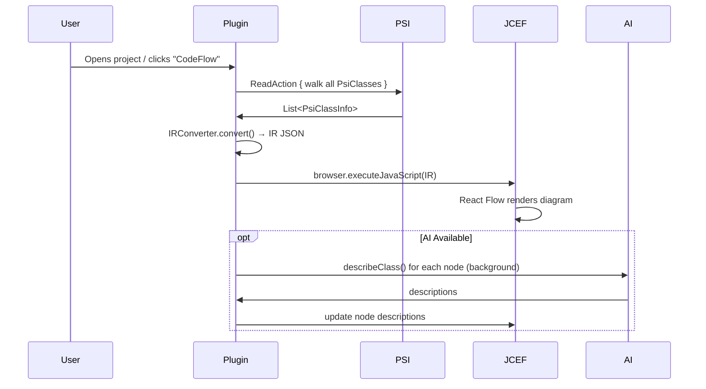
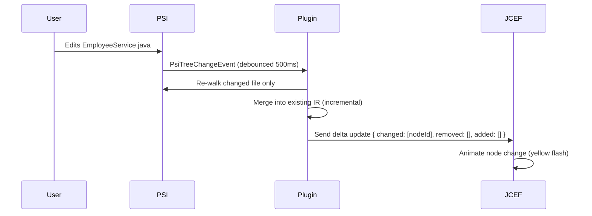
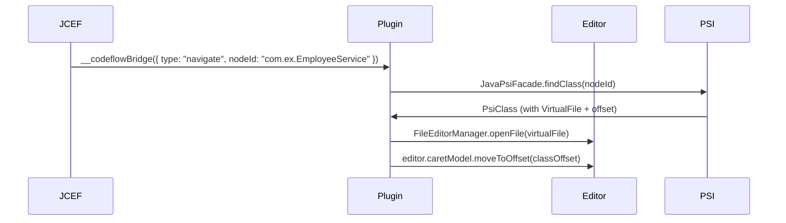

# CodeFlow IntelliJ Plugin — Product Requirements Document

**Version:** 1.0  
**Author:** Project Antigravity  
**Status:** Draft — Awaiting Approval  
**Target IDE:** IntelliJ IDEA (Community + Ultimate), Android Studio  
**Language:** Kotlin  
**Build:** Gradle (IntelliJ Platform Plugin Template)

---

## 1. Product Vision

### One-liner
> CodeFlow turns any codebase into a live, interactive architectural diagram inside IntelliJ — powered by the user's existing Copilot Enterprise subscription.

### Problem Statement
Developers joining new teams or onboarding onto unfamiliar codebases spend **weeks** understanding how code flows through the system. Reading READMEs, chasing import chains, and asking colleagues "who calls what" is slow, error-prone, and doesn't scale.

### Solution
A **zero-setup IntelliJ plugin** that:
1. Reads the project's code using IntelliJ's native PSI (100% accurate type resolution)
2. Builds an interactive flow diagram in a side panel
3. Uses Copilot (already installed in the IDE) to add human-readable descriptions
4. Updates the diagram **live** as the developer edits code
5. Lets developers trace a payload through the call chain, highlighting each method

### Success Metrics
| Metric | Target |
|--------|--------|
| Time from install to first diagram | < 30 seconds |
| Diagram accuracy (nodes) | 100% (PSI-based) |
| Diagram accuracy (edges) | > 95% (resolved references) |
| Max repo size supported | 10,000+ files |
| IDE performance impact | < 5% CPU overhead |

---

## 2. User Personas

### Persona 1: New Team Member ("Onboarder")
- **Context:** Just joined a team. Has a Spring Boot monolith with 400 classes open in IntelliJ.
- **Need:** Understand the architecture in 10 minutes instead of a week.
- **Key flow:** Open plugin → see layered diagram → click a Controller → sees its Service dependencies → clicks Service → reads AI description → understands the codebase.

### Persona 2: Senior Developer ("Reviewer")
- **Context:** Reviewing a PR that touches 15 files. Needs to understand the blast radius.
- **Need:** Visualize which flows a change affects.
- **Key flow:** Select changed files → see only the affected subgraph → trace payloads through the changed path.

### Persona 3: Tech Lead ("Documenter")
- **Context:** Needs to create architecture docs for a quarterly review.
- **Need:** Export a clean diagram as PNG/SVG/Mermaid for a wiki page.
- **Key flow:** Generate diagram → group by layer → export as Mermaid → paste into Confluence.

---

## 3. Feature Inventory

### Tier 1 — Core (MVP)

| ID | Feature | Description |
|----|---------|-------------|
| F1 | **Auto-Diagram Generation** | On project open, scan all classes via PSI and render an interactive graph in a tool window |
| F2 | **Layered Layout** | Auto-arrange nodes by architectural role: Controllers → Services → Repositories → Entities |
| F3 | **Edge Resolution** | Edges derived from field types, constructor params, method calls — all resolved via PSI |
| F4 | **Click-to-Navigate** | Click any node in the diagram → editor opens that file and scrolls to the class |
| F5 | **Node Detail Panel** | Click a node → side panel shows: class name, kind, methods, fields, imports, source location |
| F6 | **Zoom & Pan** | Standard canvas controls: scroll to zoom, drag to pan, minimap |
| F7 | **Search** | Search nodes by name — highlights and centers the matching node |

### Tier 2 — Interactive

| ID | Feature | Description |
|----|---------|-------------|
| F8 | **Live Update** | When user edits a file → diagram updates automatically (PSI change listener) |
| F9 | **Edge Highlighting** | Hover over a node → highlight all incoming/outgoing edges |
| F10 | **Subgraph Focus** | Right-click a node → "Show only connected" → filters to just that node's neighborhood |
| F11 | **Group Collapse** | Collapse architectural layers (e.g., collapse all DTOs into one box) |
| F12 | **Method-Level Toggle** | Toggle between class-level view and method-level view |

### Tier 3 — AI-Powered (Copilot)

| ID | Feature | Description |
|----|---------|-------------|
| F13 | **AI Descriptions** | Each node gets a 1-sentence AI description: "Handles employee CRUD REST endpoints" |
| F14 | **Flow Generation** | AI identifies and labels end-to-end flows: "Create Employee Flow: POST → Controller → Service → Repository" |
| F15 | **Explain on Hover** | Hover over a method node → tooltip with AI explanation of what it does |
| F16 | **AI Q&A** | Text input: "How does authentication work in this project?" → AI highlights the relevant subgraph |

### Tier 4 — Advanced

| ID | Feature | Description |
|----|---------|-------------|
| F17 | **Payload Tracing** | User enters sample JSON → plugin traces actual call chain via PSI (no AI needed) → animated step-by-step |
| F18 | **Export** | Export as: PNG, SVG, Mermaid markdown, PlantUML |
| F19 | **Diff Mode** | Compare two branches → show added/removed/changed nodes and edges |
| F20 | **Bookmarks** | Save specific views (zoomed to a subgraph) with a name for quick recall |
| F21 | **Multi-module** | Support Gradle/Maven multi-module projects — show module boundaries as groups |

---

## 4. Technical Architecture

### 4.1 High-Level Component Diagram

```
┌─────────────────────────────────────────────────┐
│                IntelliJ IDE                      │
│                                                  │
│ ┌──────────────┐  ┌──────────────┐              │
│ │ PSI Engine   │  │ AI Service   │              │
│ │ (IntelliJ    │  │ (Copilot via │              │
│ │  built-in)   │  │  ML API)     │              │
│ └──────┬───────┘  └──────┬───────┘              │
│        │                 │                       │
│ ┌──────▼─────────────────▼───────┐              │
│ │     CodeFlow Plugin Core       │              │
│ │                                │              │
│ │  ┌──────────┐  ┌────────────┐  │              │
│ │  │PSI Walker│→ │IR Converter│  │              │
│ │  └──────────┘  └─────┬──────┘  │              │
│ │                      │ IR JSON │              │
│ │  ┌───────────────────▼───────┐ │              │
│ │  │    WebView Bridge         │ │              │
│ │  │  (JBCefBrowser + JSQuery) │ │              │
│ │  └───────────────────┬───────┘ │              │
│ └──────────────────────│─────────┘              │
│                        │                         │
│ ┌──────────────────────▼───────────────────────┐│
│ │           JCEF Tool Window                    ││
│ │     ┌─────────────────────────────┐          ││
│ │     │   React Flow Canvas         │          ││
│ │     │   (same frontend from web)  │          ││
│ │     └─────────────────────────────┘          ││
│ └───────────────────────────────────────────────┘│
└─────────────────────────────────────────────────┘
```

### 4.2 Component Details

#### 4.2.1 PSI Walker
**Purpose:** Traverse IntelliJ's PSI tree to extract all code entities and their relationships.

**What it reads:**
```
For each PsiClass in the project:
  ├── Qualified name (com.example.EmployeeController)
  ├── Annotations (@RestController, @Service, @Entity, etc.)
  ├── Fields → PsiField.getType().resolve() → target PsiClass
  ├── Constructor params → same as fields (DI)
  ├── Methods → PsiMethod
  │     ├── Annotations (@GetMapping, etc.)
  │     ├── Parameters
  │     ├── Return type (resolved)
  │     └── Body → method calls → resolve() → target PsiMethod
  └── Implements/Extends → resolved supertype
```

**Key Kotlin code:**
```kotlin
class PsiWalker(private val project: Project) {

    fun walk(): List<PsiClassInfo> {
        val scope = GlobalSearchScope.projectScope(project)
        val psiClasses = AllClassesGetter.getJavaClasses(
            { true }, project, scope
        )

        return psiClasses.mapNotNull { psiClass ->
            ReadAction.compute<PsiClassInfo?, Throwable> {
                extractClassInfo(psiClass)
            }
        }
    }

    private fun extractClassInfo(psiClass: PsiClass): PsiClassInfo? {
        val qualifiedName = psiClass.qualifiedName ?: return null

        // Skip: anonymous, inner, generated
        if (psiClass.name == null) return null
        if (psiClass.containingFile?.virtualFile == null) return null

        val annotations = psiClass.annotations.map { it.qualifiedName ?: "" }
        val fields = psiClass.fields.mapNotNull { extractField(it) }
        val methods = psiClass.methods.mapNotNull { extractMethod(it) }
        val constructorDeps = psiClass.constructors.flatMap { extractConstructorDeps(it) }
        val superClass = psiClass.superClass?.qualifiedName

        return PsiClassInfo(
            qualifiedName = qualifiedName,
            simpleName = psiClass.name ?: qualifiedName,
            annotations = annotations,
            fields = fields,
            methods = methods,
            constructorDeps = constructorDeps,
            superClass = superClass,
            filePath = psiClass.containingFile?.virtualFile?.path ?: "",
            lineStart = /* from document */ 0,
            lineEnd = 0,
        )
    }

    private fun extractMethod(method: PsiMethod): PsiMethodInfo? {
        val calls = mutableListOf<ResolvedCall>()

        // Walk the method body to find all method calls
        method.accept(object : JavaRecursiveElementVisitor() {
            override fun visitMethodCallExpression(expr: PsiMethodCallExpression) {
                super.visitMethodCallExpression(expr)
                val resolved = expr.resolveMethod()
                if (resolved != null) {
                    val targetClass = resolved.containingClass?.qualifiedName
                    if (targetClass != null) {
                        calls.add(ResolvedCall(
                            targetClass = targetClass,
                            targetMethod = resolved.name,
                        ))
                    }
                }
            }
        })

        return PsiMethodInfo(
            name = method.name,
            visibility = method.modifierList.text.split(" ").firstOrNull() ?: "default",
            annotations = method.annotations.map { it.qualifiedName ?: "" },
            parameters = method.parameterList.parameters.map {
                ParamInfo(it.name ?: "", it.type.presentableText)
            },
            returnType = method.returnType?.presentableText ?: "void",
            calls = calls,
        )
    }
}
```

#### 4.2.2 IR Converter
**Purpose:** Transform PSI data into the Universal IR JSON format (same schema the web tool uses).

```kotlin
class IRConverter {

    fun convert(
        classes: List<PsiClassInfo>,
        projectName: String,
    ): UniversalIR {
        val nodeMap = mutableMapOf<String, IRNode>()
        val edges = mutableListOf<IREdge>()

        // Pass 1: Create nodes
        for (cls in classes) {
            val kind = classifyKind(cls.simpleName, cls.annotations)
            val node = IRNode(
                id = cls.qualifiedName,
                label = cls.simpleName,
                kind = kind,
                // ... fill all fields from PsiClassInfo
            )
            nodeMap[cls.qualifiedName] = node
        }

        // Pass 2: Build edges from resolved references
        for (cls in classes) {
            val sourceId = cls.qualifiedName

            // Field dependencies
            for (field in cls.fields) {
                val targetId = field.resolvedType
                if (targetId in nodeMap && targetId != sourceId) {
                    edges.add(IREdge(
                        id = "${sourceId}__${targetId}",
                        source = sourceId,
                        target = targetId,
                        kind = "depends-on",
                        label = "${field.name}: ${field.typeName}",
                    ))
                }
            }

            // Method call edges (method-level call graph)
            for (method in cls.methods) {
                for (call in method.calls) {
                    if (call.targetClass in nodeMap && call.targetClass != sourceId) {
                        edges.add(IREdge(
                            id = "${sourceId}__${call.targetClass}__calls__${method.name}",
                            source = sourceId,
                            target = call.targetClass,
                            kind = "calls",
                            label = "${method.name}() → ${call.targetMethod}()",
                        ))
                    }
                }
            }
        }

        return UniversalIR(
            project = ProjectMeta(name = projectName),
            nodes = nodeMap.values.toList(),
            edges = edges,
        )
    }
}
```

#### 4.2.3 JCEF WebView Bridge
**Purpose:** Host the React Flow canvas inside IntelliJ and enable bidirectional communication.

```
Plugin (Kotlin)              WebView (JavaScript)
      │                             │
      │  ── sendIR(json) ──────►    │  Receives IR, renders graph
      │                             │
      │  ◄── onNodeClick(id) ────   │  User clicks a node
      │                             │
      │  ── highlightNode(id) ──►   │  Plugin highlights a node
      │                             │
      │  ◄── onTraceRequest ─────   │  User requests payload trace
      │                             │
```

**Implementation:**
```kotlin
class CodeFlowToolWindowFactory : ToolWindowFactory {

    override fun createToolWindowContent(project: Project, toolWindow: ToolWindow) {
        if (!JBCefApp.isSupported()) {
            // Fallback: show message that JCEF is required
            return
        }

        val browser = JBCefBrowser()
        val jsQuery = JBCefJSQuery.create(browser as JBCefBrowserBase)

        // Handle messages FROM the WebView (node clicks, trace requests)
        jsQuery.addHandler { message ->
            val action = Json.parseToJsonElement(message).jsonObject
            when (action["type"]?.jsonPrimitive?.content) {
                "navigate" -> {
                    val nodeId = action["nodeId"]?.jsonPrimitive?.content
                    navigateToClass(project, nodeId)
                }
                "trace" -> {
                    val payload = action["payload"]?.jsonObject
                    runPayloadTrace(project, payload)
                }
            }
            JBCefJSQuery.Response("ok")
        }

        // Load the React app from plugin resources
        val htmlUrl = this::class.java.getResource("/webview/index.html")
        browser.loadURL(htmlUrl?.toExternalForm() ?: "about:blank")

        // Inject the callback bridge after page loads
        browser.jbCefClient.addLoadHandler(object : CefLoadHandlerAdapter() {
            override fun onLoadEnd(b: CefBrowser, frame: CefFrame, httpStatusCode: Int) {
                val bridgeJs = """
                    window.__codeflowBridge = function(msg) {
                        ${jsQuery.inject("msg")}
                    };
                """
                b.executeJavaScript(bridgeJs, b.url, 0)

                // Send initial IR
                val ir = generateIR(project)
                val irJson = Json.encodeToString(ir)
                b.executeJavaScript(
                    "window.__codeflowReceiveIR($irJson);",
                    b.url, 0
                )
            }
        }, browser.cefBrowser)

        // Add to tool window
        val content = ContentFactory.getInstance()
            .createContent(browser.component, "CodeFlow", false)
        toolWindow.contentManager.addContent(content)

        // Listen for PSI changes → live update
        PsiManager.getInstance(project).addPsiTreeChangeListener(
            object : PsiTreeChangeAdapter() {
                override fun childrenChanged(event: PsiTreeChangeEvent) {
                    // Debounce + regenerate IR + send to browser
                    scheduleIRUpdate(project, browser)
                }
            },
            toolWindow.disposable
        )
    }
}
```

#### 4.2.4 AI Integration (Copilot via JetBrains ML API)

```kotlin
class CopilotDescriber(private val project: Project) {

    /**
     * Uses whatever AI provider the user has configured in IntelliJ
     * (Copilot, JetBrains AI Assistant, or none).
     *
     * Falls back gracefully if no AI is available.
     */
    suspend fun describeClass(className: String, codeSnippet: String): String? {
        return try {
            // JetBrains AI Platform API (works with Copilot extension)
            val aiService = project.service<com.intellij.ai.AIService>()

            val prompt = """
                Describe this class in exactly one sentence.
                Class: $className
                Code:
                ```
                ${codeSnippet.take(2000)}
                ```
                Reply with only the description, no explanation.
            """.trimIndent()

            aiService.chat(prompt).firstOrNull()?.text
        } catch (e: Exception) {
            // AI not available — return null, plugin works without it
            null
        }
    }

    suspend fun generateFlowLabel(
        steps: List<String>, // ["EmployeeController.create", "EmployeeService.save", "EmployeeRepo.persist"]
    ): String? {
        return try {
            val aiService = project.service<com.intellij.ai.AIService>()
            val prompt = """
                Name this execution flow in 3-5 words.
                Steps: ${steps.joinToString(" → ")}
                Reply with only the name.
            """.trimIndent()
            aiService.chat(prompt).firstOrNull()?.text
        } catch (e: Exception) {
            null
        }
    }
}
```

> [!NOTE]
> The AI integration is **optional**. The plugin works perfectly without any AI provider.
> AI only adds descriptions and flow labels — the graph structure comes from PSI (deterministic).

---

## 5. UX Design

### 5.1 Plugin Location
The plugin adds a **Tool Window** anchored to the **right side** of the IDE (same position as the Maven/Gradle panels).

### 5.2 Layout

```
┌──────────────────────────────────────────────────────────────────┐
│  IntelliJ Editor                      │  CodeFlow Panel         │
│                                       │                          │
│  ┌─────────────────────────────┐      │  ┌─────────────────────┐│
│  │ EmployeeController.java     │      │  │ [🔍 Search...     ] ││
│  │                             │      │  │                     ││
│  │ @RestController             │      │  │  ┌──────────────┐   ││
│  │ public class Employee...    │ ◄────┼──│  │ Employee     │   ││
│  │                             │ click│  │  │ Controller   │   ││
│  │   @PostMapping("/api/emp")  │      │  │  └──────┬───────┘   ││
│  │   public ResponseEntity...  │      │  │         │            ││
│  │                             │      │  │         ▼            ││
│  │                             │      │  │  ┌──────────────┐   ││
│  │                             │      │  │  │ Employee     │   ││
│  │                             │      │  │  │ Service      │   ││
│  └─────────────────────────────┘      │  │  └──────┬───────┘   ││
│                                       │  │         │            ││
│                                       │  │         ▼            ││
│                                       │  │  ┌──────────────┐   ││
│                                       │  │  │ Employee     │   ││
│                                       │  │  │ Repository   │   ││
│                                       │  │  └──────────────┘   ││
│                                       │  │                     ││
│                                       │  │  [📦 Trace] [📤]   ││
│                                       │  └─────────────────────┘│
│                                       │                          │
└──────────────────────────────────────────────────────────────────┘
```

### 5.3 Toolbar Actions

| Icon | Action | Shortcut |
|------|--------|----------|
| 🔄 | Refresh diagram | `Ctrl+Shift+G` |
| 🔍 | Search nodes | `Ctrl+F` in panel |
| 📦 | Open Payload Tracer | — |
| 📤 | Export (PNG/Mermaid) | — |
| 🎯 | Focus current file | `Ctrl+Shift+L` |
| 🔀 | Toggle class/method view | — |
| 🤖 | Run AI descriptions | — |

### 5.4 Context Menu (Right-click on Node)

```
┌────────────────────────────┐
│ 📂 Open in Editor          │
│ 🔍 Show Usages            │
│ 🎯 Focus Neighborhood      │
│ 🤖 AI: Explain this class  │
│ 📦 Trace from here...      │
│ ─────────────────────────  │
│ 📋 Copy qualified name     │
│ 🔗 Copy as Mermaid node    │
└────────────────────────────┘
```

---

## 6. Data Flow

### 6.1 Initial Load



### 6.2 Live Update (Code Change)



### 6.3 Click-to-Navigate



---

## 7. Data Model (IR Schema)

The plugin produces the **exact same IR schema** as the web tool. This means:
- The React canvas code is **reused unchanged**
- IR can be exported as JSON and opened in the web tool
- Future: IR can be shared between teammates

Core types (already defined in the web tool):
```
UniversalIR
  ├── project: ProjectMeta
  ├── nodes: IRNode[]
  │     ├── id (qualified class name)
  │     ├── label (simple class name)
  │     ├── kind (controller, service, repository, ...)
  │     ├── description (from AI, optional)
  │     ├── source { filePath, lineStart, lineEnd }
  │     ├── structure { exports, imports, annotations }
  │     └── canvas { position, pinned }
  ├── edges: IREdge[]
  │     ├── source → target (qualified names)
  │     ├── kind (depends-on, calls, implements)
  │     └── confidence { source: "psi", score: 1.0 }
  ├── groups: IRGroup[]
  └── flows: IRFlow[]
```

---

## 8. Plugin Configuration (`plugin.xml`)

```xml
<idea-plugin>
    <id>com.codeflow.plugin</id>
    <name>CodeFlow — Live Architecture Diagrams</name>
    <vendor>Project Antigravity</vendor>
    <description>
        Interactive flow diagrams from your code.
        Powered by IntelliJ PSI + Copilot.
    </description>

    <depends>com.intellij.modules.platform</depends>
    <depends>com.intellij.modules.java</depends>
    <!-- Optional: AI features only if Copilot/AI Assistant is installed -->
    <depends optional="true" config-file="ai-features.xml">
        com.intellij.modules.ai
    </depends>

    <extensions defaultExtensionNs="com.intellij">
        <!-- Tool Window -->
        <toolWindow id="CodeFlow"
                    anchor="right"
                    icon="/icons/codeflow-13.svg"
                    factoryClass="com.codeflow.plugin.ui.CodeFlowToolWindowFactory"/>

        <!-- Project-level service (holds current IR state) -->
        <projectService
            serviceImplementation="com.codeflow.plugin.services.CodeFlowProjectService"/>

        <!-- Startup activity (pre-index on project open) -->
        <postStartupActivity
            implementation="com.codeflow.plugin.startup.CodeFlowStartupActivity"/>
    </extensions>

    <actions>
        <group id="CodeFlow.Actions" text="CodeFlow" popup="true">
            <add-to-group group-id="ToolsMenu" anchor="last"/>
            <action id="CodeFlow.Refresh"
                    class="com.codeflow.plugin.actions.RefreshDiagramAction"
                    text="Refresh Diagram"
                    icon="/icons/refresh.svg">
                <keyboard-shortcut keymap="$default"
                                   first-keystroke="ctrl shift G"/>
            </action>
            <action id="CodeFlow.FocusCurrentFile"
                    class="com.codeflow.plugin.actions.FocusCurrentFileAction"
                    text="Focus Current File in Diagram">
                <keyboard-shortcut keymap="$default"
                                   first-keystroke="ctrl shift L"/>
            </action>
            <action id="CodeFlow.ExportMermaid"
                    class="com.codeflow.plugin.actions.ExportMermaidAction"
                    text="Export as Mermaid"/>
        </group>
    </actions>
</idea-plugin>
```

---

## 9. File Structure

```
codeflow-intellij-plugin/
├── build.gradle.kts              # Gradle IntelliJ Plugin build config
├── settings.gradle.kts
├── gradle.properties             # Target IDE version, plugin metadata
├── src/
│   └── main/
│       ├── kotlin/com/codeflow/plugin/
│       │   ├── model/
│       │   │   ├── IRNode.kt           # IR data classes (mirrors backend)
│       │   │   ├── IREdge.kt
│       │   │   ├── IRFlow.kt
│       │   │   ├── UniversalIR.kt
│       │   │   └── PsiClassInfo.kt     # PSI extraction data classes
│       │   ├── analysis/
│       │   │   ├── PsiWalker.kt        # Traverses PSI tree
│       │   │   ├── IRConverter.kt      # PSI → IR conversion
│       │   │   ├── CallGraphBuilder.kt # Method-level call graph
│       │   │   └── FlowDetector.kt     # Detects end-to-end flows
│       │   ├── ai/
│       │   │   ├── CopilotDescriber.kt # AI descriptions via ML API
│       │   │   └── FlowLabeler.kt      # AI flow naming
│       │   ├── ui/
│       │   │   ├── CodeFlowToolWindowFactory.kt
│       │   │   ├── WebViewBridge.kt    # JCEF ↔ Kotlin messaging
│       │   │   └── DiagramActions.kt   # Toolbar actions
│       │   ├── services/
│       │   │   ├── CodeFlowProjectService.kt  # Holds IR state
│       │   │   └── LiveUpdateService.kt       # PSI change debouncer
│       │   ├── actions/
│       │   │   ├── RefreshDiagramAction.kt
│       │   │   ├── FocusCurrentFileAction.kt
│       │   │   └── ExportMermaidAction.kt
│       │   └── startup/
│       │       └── CodeFlowStartupActivity.kt
│       └── resources/
│           ├── META-INF/
│           │   ├── plugin.xml
│           │   └── ai-features.xml   # Optional AI extension point
│           ├── icons/
│           │   └── codeflow-13.svg
│           └── webview/
│               ├── index.html        # Entry point for JCEF
│               ├── bundle.js         # Built React Flow canvas
│               └── styles.css
├── webview-src/                      # Source for the embedded React app
│   ├── package.json
│   ├── src/
│   │   ├── App.tsx                   # React Flow canvas (shared with web tool)
│   │   ├── bridge.ts                 # __codeflowBridge integration
│   │   └── components/              # Reused from web tool frontend
│   └── vite.config.ts               # Builds to ../src/main/resources/webview/
└── README.md
```

---

## 10. Implementation Phases

### Phase 1 — Skeleton (Week 1)
- [ ] Set up Kotlin Gradle IntelliJ Plugin project
- [ ] Create tool window with JBCefBrowser (show "Hello World" HTML)
- [ ] Implement basic PsiWalker (extract all PsiClasses + fields)
- [ ] Implement basic IRConverter (nodes only, no edges)
- [ ] Send IR JSON to WebView and render nodes

**Deliverable:** Open any Java project → see boxes for each class in a side panel.

### Phase 2 — Edges & Navigation (Week 2)
- [ ] Add field/constructor/call resolution to PsiWalker
- [ ] IRConverter produces edges from resolved references
- [ ] Implement click-to-navigate (WebView → Kotlin → open file)
- [ ] Add architectural layout (layer nodes by kind)
- [ ] Add search functionality

**Deliverable:** Full interactive diagram with edges, click-to-navigate, and layered layout.

### Phase 3 — Live Updates & AI (Week 3)
- [ ] PsiTreeChangeListener for live diagram updates
- [ ] Debounced incremental IR updates
- [ ] AI description generation via JetBrains ML API
- [ ] Flow detection from call graph
- [ ] Node detail panel

**Deliverable:** Diagram updates live as you type. AI descriptions on nodes.

### Phase 4 — Polish & Ship (Week 4)
- [ ] Payload tracing mode
- [ ] Export (PNG, Mermaid)
- [ ] Group collapse/expand
- [ ] Method-level toggle
- [ ] Performance optimization for large repos
- [ ] JetBrains Marketplace submission

**Deliverable:** Production-ready plugin on JetBrains Marketplace.

---

## 11. Performance Considerations

| Concern | Mitigation |
|---------|-----------|
| PSI traversal on 10K-file repo | Run in background thread (`ReadAction` + `Task.Backgroundable`). Index only project-scope classes. |
| Live update on every keystroke | Debounce to 500ms. Only re-walk the changed file, merge into existing IR. |
| JCEF memory for large graphs | Virtualize: only render visible nodes. Collapse groups by default. |
| AI calls for 500 nodes | Batch in groups of 10. Background thread. Cache descriptions in project-level service. |

---

## 12. Testing Strategy

| Layer | Approach |
|-------|----------|
| PSI Walker | Unit test with `LightJavaCodeInsightFixtureTestCase` — create in-memory Java files, verify extracted info |
| IR Converter | Unit test: given PsiClassInfo list → verify IR JSON structure |
| WebView Bridge | Manual: verify JS messages round-trip with Chrome DevTools (JCEF debug mode) |
| Integration | `HeavyIdeaTestFixtureImpl` — open a real project, verify full pipeline |
| AI | Mock `AIService` in tests — verify prompt format, handle null responses |

---

## 13. Risks & Mitigations

| Risk | Likelihood | Impact | Mitigation |
|------|-----------|--------|-----------|
| Copilot extension API changes | Medium | Low | AI is optional. Plugin works 100% without it. Use `optional="true"` dependency. |
| JCEF not available (e.g., remote dev) | Low | High | Detect with `JBCefApp.isSupported()`. Fallback to plain Swing tree view. |
| PSI resolution incomplete (generated code) | Medium | Low | Show unresolved edges as dashed. Log warning. |
| Large repos slow to index | Medium | Medium | Background indexing with progress bar. Incremental updates. |
| JetBrains Marketplace review rejection | Low | Medium | Follow plugin guidelines. No bundled LLMs. No external network calls (AI goes through IntelliJ's own APIs). |

---

## 14. Dependencies

| Dependency | Version | Purpose |
|-----------|---------|---------|
| IntelliJ Platform SDK | 2024.1+ | Plugin API, PSI, JCEF |
| Kotlin | 1.9+ | Plugin language |
| kotlinx.serialization | 1.6+ | JSON serialization for IR |
| React Flow | 12+ | Diagram rendering (in WebView) |
| Vite | 5+ | Build tool for WebView frontend |

---

## 15. Open Questions

> [!IMPORTANT]
> **Decision needed from you:**
>
> 1. **Scope for v1:** Should the MVP include AI descriptions, or just the PSI-based diagram?
> 2. **Kotlin support:** Should the plugin support Kotlin codebases in v1, or start Java-only?
> 3. **Plugin name:** "CodeFlow" or something else for the JetBrains Marketplace?
> 4. **Multi-module:** Should v1 support Maven/Gradle multi-module projects?
